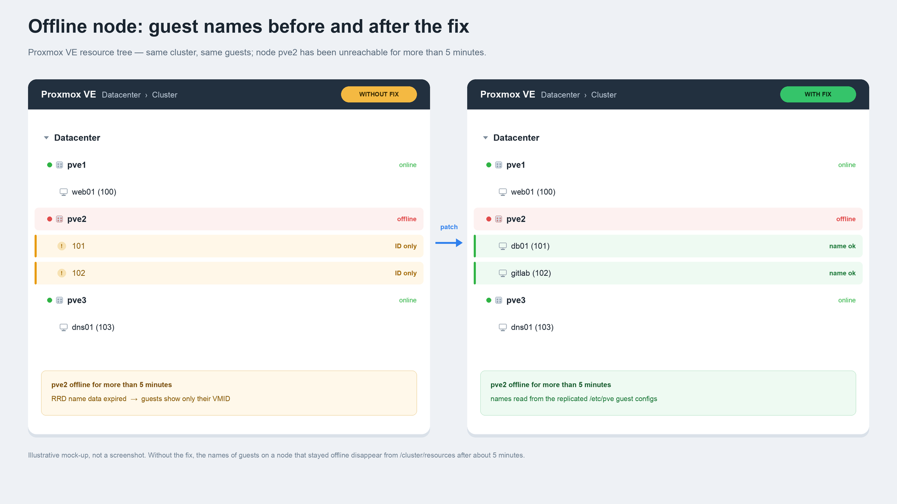

# Proxmox VE: keep VM/CT names visible when a node is down

When a Proxmox VE cluster node goes offline, the web UI keeps listing the guests
that live on it (from the replicated guest configs, `/etc/pve/nodes/<node>/...`),
but only by ID: `100`, `101`, `CT 102` — no names, no hostnames. The names come
back only when the node comes back.

That is not a data problem. The configs are on every node. The API is simply not
using them for the name field, and the one source it does use (live RRD status)
is discarded 5 minutes after the owning node stops refreshing it.

This repo contains the source-level analysis and a small patch for
`pve-manager` that makes `/cluster/resources` fall back to the replicated guest
configs, so the GUI (and `pvesh`, the mobile app, any API client) keeps showing
names while at least one cluster node is up.



## Root cause

1. The GUI gets VM/CT entries from `GET /cluster/resources`. The handler is
   `PVE::API2::Cluster::get_resources()` in `pve-manager`'s
   `PVE/API2/Cluster.pm`. Each guest entry is built by
   `PVE::API2Tools::extract_vm_stats()` (`PVE/API2Tools.pm`):

   ```perl
   my $entry = {
       id => "$data->{type}/$vmid",
       vmid => $vmid + 0,
       node => $data->{node},
       type => $data->{type},
       status => 'unknown',
   };
   ...
   if (my $d = $rrd->{$key}) {
       $entry->{name} = $d->[1];   # <-- the only name the resource API ever sets
       $entry->{status} = $d->[2];
       ...
   }
   ```

   `$rrd` is `PVE::Cluster::rrd_dump()`. There is no other name source: the guest
   list (`get_vmlist()`, which comes from pmxcfs and includes offline nodes) only
   carries `vmid`/`node`/`type`.

2. The RRD row containing the name is broadcast by the node that runs the guest.
   `PVE::Service::pvestatd` broadcasts the guest row via
   `PVE::Cluster::broadcast_rrd("pve-vm-9.0/$vmid", $data)` (older installations use
   `pve2.3-vm/$vmid`), with `$d->{name}` from the VM status. Every cluster node receives that update
   into pmxcfs' in-memory status table.

3. Those entries are deliberately short-lived. In `pve-cluster`,
   `src/pmxcfs/status.c`:

   ```c
   /* remove everything older than 5 minutes */
   int expire = 60 * 5;
   ```

   `cfs_rrd_dump()` removes stale entries before serving the dump. When a node
   goes down it stops refreshing its guests' rows, so after 5 minutes
   `/cluster/resources` returns those guests without `name` (and without live
   status/cpu/uptime). The GUI then renders the VMID only
   (`ResourceStore.js` `text`/`name` fields, `ResourceTree.js` label renderer).

   That 5-minute delay is also the easiest way to confirm this diagnosis: keep a
   node down and watch the names stay for a few minutes, then disappear.

4. Meanwhile the guest configs are still there, cluster-wide:
   `/etc/pve/nodes/<node>/qemu-server/<vmid>.conf` (`name: ...`) and
   `/etc/pve/nodes/<node>/lxc/<vmid>.conf` (`hostname: ...`). pmxcfs replicates
   them to every node and keeps serving them while the owning node is offline.

5. The API already reads those configs fast, cluster-wide, for `lock` and `tags`:
   `PVE::Cluster::get_guest_config_properties()` (a pmxcfs IPC call that reads the
   in-memory config database). It just never asks for `name`/`hostname`.

So the answer to "why can't the GUI show hostnames while at least one node is
up?": it can — the data is local and cheap; the API just ignores it for the name
field. This patch makes it use it.

## The fix

`patches/show-hostnames.patch` changes only
`PVE/API2/Cluster.pm`:

- add `name` and `hostname` (LXC's name property) to the existing
  `get_guest_config_properties([qw(lock tags)])` query, and
- fall back to the config name when the RRD name is gone; `hostname` is mapped to
  the `name` field, everything else stays as before.

Result: `qemu` and `lxc` entries always get `name` from the replicated config,
even on a node that has been offline for hours. The fix is server-side, so the
web UI, `pvesh`, mobile app and any API consumer all benefit. The fix itself
adds no daemon or dependency.

Verified against `pve-manager` 9.2.25 (`master`) and 8.4.22 (`stable-8`); the
patch applies cleanly to both.

## Apply

Requires PVE 8.x or 9.x (the `lock`/`tags` config-property query this patch
extends). The patched code must be on every node that answers the web UI/API:
each node serves the API from its own copy.

From one node with this repository checked out, the cluster-wide script walks
all online nodes over SSH (cluster nodes have passwordless root SSH). It uses
each node's name and falls back to the IP from `/cluster/status` when that name
does not resolve on the driving node. For that fallback it verifies the host key
against the node's pinned key in `/etc/pve/nodes/<node>/ssh_known_hosts`, so a
missing or stale local `known_hosts` entry does not break the rollout:

```sh
sudo ./scripts/patch-show-hostnames-all.sh
```

Offline nodes are skipped and reported (exit 1); rerun when they are back.
For a single node:

```sh
sudo ./scripts/patch-show-hostnames.sh --persist
```

Without `--persist` the script only patches the local node. With `--persist`
(and the cluster-wide script) it also installs an APT hook:

- `/etc/apt/apt.conf.d/86proxmox-show-hostnames` re-applies the patch after a
  `pve-manager` upgrade: `DPkg::Pre-Install-Pkgs` arms it only when
  `pve-manager` is in the transaction, `DPkg::Post-Invoke` applies it after
  dpkg finishes.
- the hook runs an installed copy under `/usr/local/lib/proxmox-show-hostnames/`,
  so the repository does not have to stay on the node.
- output goes to `/var/log/proxmox-show-hostnames.log`; if a future
  `pve-manager` breaks the patch context, apt still succeeds and the log shows
  the failure (names fall back to IDs until the patch is updated).

The script backs up `Cluster.pm` to `/root/`, applies the patch, runs `perl -c`
(restoring the backup on failure) and restarts `pvedaemon`/`pveproxy` only
when it changed the file. Re-running it is a no-op.

## Verify

Reproduce first: with one node offline for more than 5 minutes, before the fix:

```sh
sudo ./scripts/check-hostnames.sh
# guests without name (API would show IDs only):
#   qemu 100 on pve2
#   lxc 101 on pve2
```

After applying the fix on the surviving node, the same command must pass even
while `pve2` is still down:

```sh
sudo ./scripts/check-hostnames.sh
# OK: 12 guests, all names present
```

Then reload the GUI (`Datacenter` cluster view, node tree, search): the offline
node's guests show names again. The online guests are unaffected.

## Roll back

```sh
sudo ./scripts/patch-show-hostnames-all.sh --revert   # all online nodes
sudo ./scripts/patch-show-hostnames.sh --revert       # only this node
```

That removes the APT hook and the installed copy, then reverts the patch (and
restarts `pvedaemon`/`pveproxy` only if it was applied). Offline nodes still
need a rerun when they are back.

## Limitations / notes

- A guest only shows a name if its config has one. QEMU VMs created without
  `name:` and containers without `hostname:` have nothing to show; the GUI keeps
  showing the VMID for them. Everything else is unaffected.
- Patch all nodes: the fix is in the API process, not in pmxcfs, so a request
  answered by an unpatched node still returns unnamed entries.
- `pve-manager` package upgrades overwrite `/usr/share/perl5/PVE/API2/Cluster.pm`.
  With `--persist` the APT hook re-applies the patch after such upgrades; it
  only fires on apt/dpkg transactions, not on manual edits. If a new
  `pve-manager` changes the file enough that the patch no longer applies, the
  hook logs the failure to `/var/log/proxmox-show-hostnames.log` and apt
  continues; update the patch (or use the upstream fix) and rerun the script.
  The hook uses the same `DPkg::Pre-Install-Pkgs` / `DPkg::Post-Invoke` pattern
  as the popular pve-nag-buster patch.
- The cluster-wide script skips offline nodes and exits 1; rerun it once they
  are back. If a future upstream release fixes this, `grep 'name hostname'`
  makes the per-node script a no-op.
- The names are the guest config names, which is exactly what the GUI displays
  today for online guests. Nothing else about the API changes for online guests.
- Tested here: source analysis, patch applies cleanly to 8.x and 9.x trees, and
  the scripts' apply/persist/upgrade-hook/revert flow exercised in a sandbox.
  Not run against a live cluster from this repo — use `check-hostnames.sh`
  before/after on yours as the acceptance test.

## Alternatives considered

- **Keep RRD entries for offline nodes in pmxcfs.** Requires patching/rebuilding
  C code in `pve-cluster` on every node and cluster-wide restart, and it would
  keep stale live statistics (status, CPU, memory) alive forever. The 5-minute
  expiry exists on purpose; the name doesn't need it.
- **Read `/etc/pve` from the GUI (browser).** The browser cannot read the
  node's filesystem; the API endpoint is the correct place.
- **Per-node guest list endpoints (e.g. `/nodes/<node>/qemu`).** These are
  answered by the node itself and fail when the node is down; that's why the
  cluster-wide `/cluster/resources` view is the right hook.
- **CLI-only mapping script** (parse `/etc/pve/nodes/*/...` and print
  VMID → name): useful as a workaround, but it doesn't put names into the GUI.

## Sources

- `pve-manager`: `PVE/API2/Cluster.pm` (`get_resources`), `PVE/API2Tools.pm`
  (`extract_vm_stats`), `PVE/Service/pvestatd.pm`, `www/manager6/data/ResourceStore.js`,
  `www/manager6/tree/ResourceTree.js`.
- `pve-cluster`: `src/pmxcfs/status.c` (`rrd_entry_is_old`, `cfs_rrd_dump`),
  `src/PVE/Cluster.pm` (`get_guest_config_properties`).
- Repos: <https://git.proxmox.com/?p=pve-manager.git> and
  <https://git.proxmox.com/?p=pve-cluster.git>.
